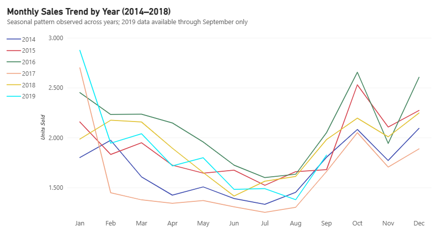
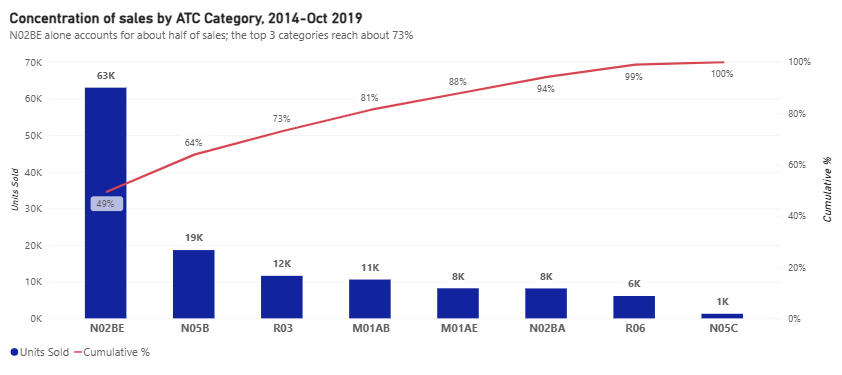
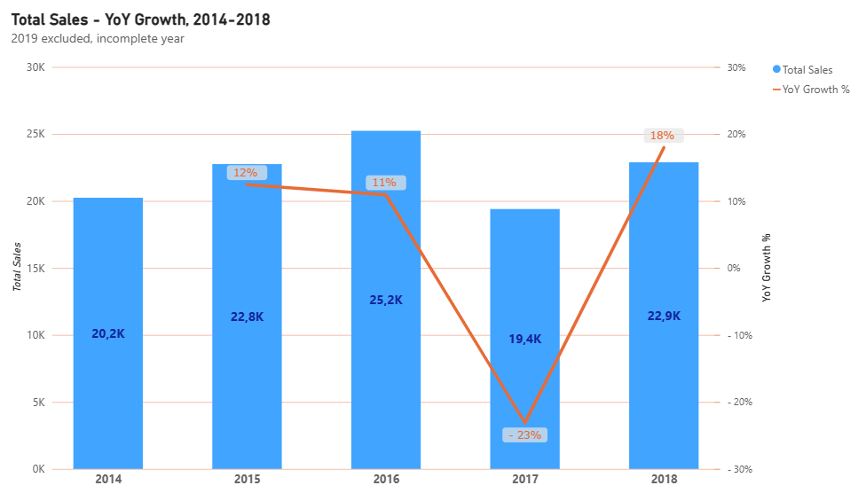
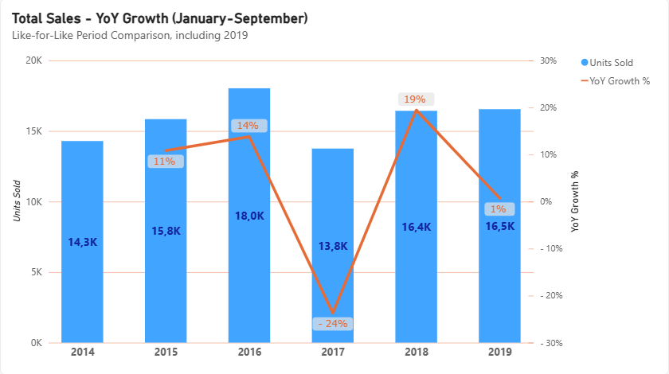
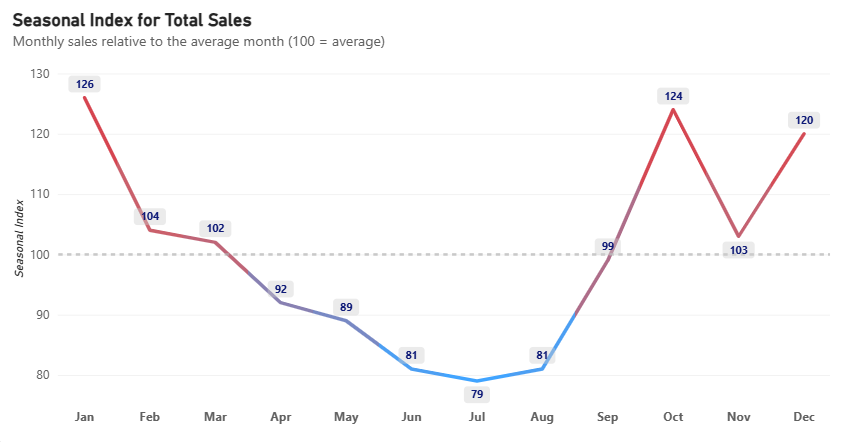
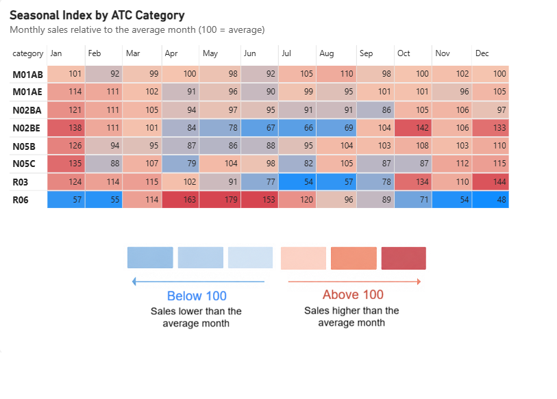
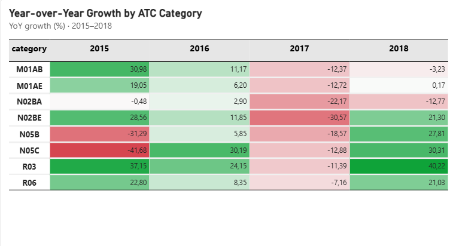
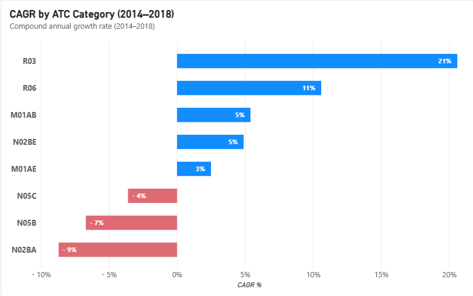

# Pharmaceutical Sales Analysis by ATC Category

Analysis of almost six years of daily pharmaceutical sales across 8 ATC drug categories: which categories drive sales, how sales evolved year by year, and how strongly they follow the seasons. Built with PostgreSQL (data checks and analysis) and Power BI (visuals).

## Key findings

- Sales are highly concentrated. **N02BE** alone accounts for 49.38% of total sales, and the top 3 categories (**N02BE**, **N05B**, **R03**) reach 73.09%.
- 2017 was a break in the series. Total sales grew until 2016, then fell 23.12% in 2017, with all 8 categories declining at the same time. The data does not show the cause.
- Growth is uneven across categories. **R03** and **R06** grow most consistently, **N02BA** is the only category in sustained decline, and the rest follow mixed paths.
- Seasonality is clear. Total sales are above the average month from October to March and below it from April to September. **R06** is the exception: it peaks in spring.

<kbd>  </kbd>

## Business context and questions

A company that sells or distributes medicines needs to know which product groups carry its sales, whether they are growing, and when demand peaks, to support decisions such as stock planning and campaign timing. This project answers four questions with that in mind:

1. Which ATC categories concentrate most of the sales?
2. How have total sales evolved over the years?
3. Is there a seasonal pattern in pharmaceutical sales?
4. Which categories are growing or declining year over year?

## Data

- Source: Kaggle, "Pharma sales data" (sales of drugs classified in 8 ATC categories, January 2014 to October 2019). Provided at four granularities: hourly, daily, weekly and monthly.
- Period: starts on 2 January 2014 and ends on 8 October 2019, so 2019 is an incomplete year.
- Unit of sales: units sold, not revenue. Throughout this README, "sales" means units sold, so the shares and trends below describe volume and not value.
- ATC Category	Description:

| ATC Category | Description |
|---|---|
| M01AB | Anti-inflammatory and antirheumatic products, acetic acid derivatives |
| M01AE | Anti-inflammatory and antirheumatic products, propionic acid derivatives |
| N02BA | Other analgesics and antipyretics, salicylic acid and derivatives |
| N02BE | Other analgesics and antipyretics, anilides |
| N05B | Psycholeptics, anxiolytics |
| N05C | Psycholeptics, hypnotics and sedatives |
| R03 | Drugs for obstructive airway diseases |
| R06 | Antihistamines for systemic use |

### Data quality

The four raw tables were loaded unchanged into PostgreSQL and checked before any analysis. The hourly, daily and weekly tables add up to the same total. The monthly table does not match the daily one in 8 months (one of them at zero), so all monthly figures in this project are built from the daily table.  Details are in [`sql/02_Data_Quality_Check.sql`](sql/02_Data_Quality_Check.sql).

## Analysis

### 1. Which ATC categories concentrate most of the sales?
- **N02BE** is the leading category, accounting for 49.38% of total sales, followed by **N05B** with 14.61%.
- The top 3 categories (**N02BE**, **N05B**, **R03**) reach 73.09% of total sales, a high concentration in a small number of categories.
- **N05C** is the smallest category, with only 0.98% of total sales.

<kbd>  </kbd>

### 2. How have total sales evolved over the years?
- Sales grew from 2014 to 2016 (+12.42% in 2015, +10.91% in 2016).
- They then fell 23.12% in 2017. The data does not show the cause.
- 2018 rebounded +17.97%, back to the average level of 2014-2016 but still about 9% below the 2016 peak.
- Comparing January to September in every year so that 2019 can be included, 2019 is flat versus 2018 (+0.70%). This excludes October to December, so it should not be extrapolated to the full year.

<kbd>  </kbd> <kbd>  </kbd>

### 3. Is there a seasonal pattern in pharmaceutical sales?

The seasonal index compares each month with the average month (100 = average).

**Total sales**

- Sales are generally above average from October to March and below average from April to September, revealing a clear winter-driven seasonal pattern.
- January (index 126) and December (120) record the highest sales, 26% and 20% above the average month, respectively.
- The lowest sales occur in June (81), July (79) and August (81), approximately 19–21% below average.

<kbd>  </kbd>

**By category**

- **N02BE** and **R03** reinforce the overall seasonal pattern, with pronounced winter peaks and summer declines. **N02BE** ranges from 66 in July (34% below average) to 138 in January (38% above average). **R03** ranges from 54 in July (46% below average) to 144 in December (44% above average).
- **R06** shows the opposite pattern, with below-average sales during winter and above-average sales in spring and early summer. Its lowest indices are in December (48) and January (57), while April (163), May (179) and June (153) record sales 63%, 79% and 53% above average, respectively.

<kbd>  </kbd>

### 4. Which categories are growing or declining year over year?

- ***Growing:*** **R03** (CAGR 2014-2018: 20.6%) and R06 (10.6%) grew in three of the four years. Their only decline was in 2017 (-11.39% and -7.16%), and 2018 is the highest year of the series for both.

- ***Declining:*** **N02BA** is the only category in sustained decline (CAGR -8.7%). It grew only in 2016 (+2.90%), and 2018 is its lowest year.

- ***Mixed:*** **N02BE** (CAGR 4.9%) is highly volatile, with -30.57% in 2017 and +21.30% in 2018. **N05C** swings between -41.68% (2015) and +30.31% (2018). **M01AB** and **M01AE** peaked in 2016 and have declined or stagnated since, so their positive CAGR (5.4% and 2.5%) overstates their recent trend.
  
- All 8 categories fell in 2017, the largest drop being **N02BE** (-30.57%), which points to a common factor. The data does not show its cause.
- CAGR depends on the starting year. The negative CAGR of **N05B** and **N05C** is driven by a high 2014 and should be read together with the year-over-year table.

<kbd>  </kbd>
<kbd>  </kbd>

## Recommendations

Based on the observed sales patterns, the analysis suggests several opportunities for improving inventory planning and demand forecasting:

- **Seasonal stock planning:** Adjust inventory levels according to the seasonal index of each ATC category, anticipating higher demand during peak months and lower demand during off-peak periods.

- **Category-specific planning:** Consider different seasonal patterns across categories. While N02BE and R03 show higher sales during winter, R06 peaks in spring and early summer. Applying a single seasonal strategy across all categories may therefore be inefficient.

- **Demand forecasting:** Use historical monthly sales and seasonal indices as a starting point for forecasting future demand, while incorporating additional data to improve forecast accuracy.

These recommendations are based on historical sales patterns and should be validated against actual inventory levels, stock availability and operational constraints before implementation.

## Limitations

- **Limited business context:** The dataset contains sales volumes but does not include pricing, revenue or patient numbers. Consequently, it is not possible to assess price trends, patient demand or the underlying drivers of sales changes.

- **Incomplete 2019 data:** The dataset only covers January to early October 2019. Therefore, 2019 was excluded from analyses requiring complete calendar years, such as CAGR and seasonal comparisons.

- **Unexplained sales decline:** The observed decline in sales in 2017 cannot be attributed to a specific cause, as the dataset does not provide additional market or business context.

- **CAGR sensitivity:** CAGR results depend on the selected starting and ending years and may not fully reflect intermediate fluctuations, particularly when analysing periods with significant changes in sales.
